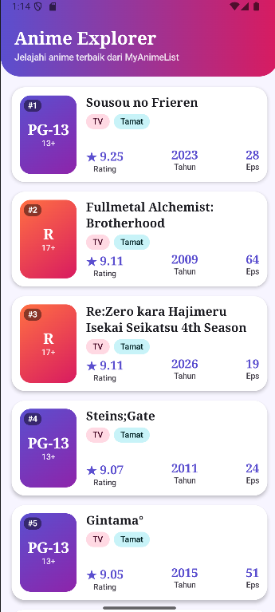
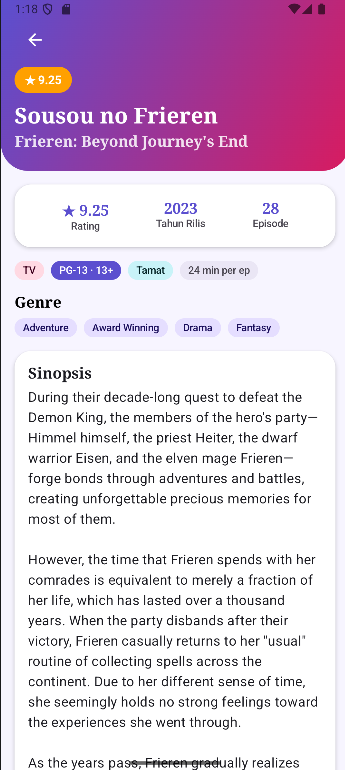
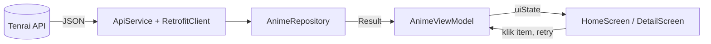

# 🎌 Anime Explorer

Aplikasi mobile Android sederhana untuk menjelajahi daftar anime. Data diambil secara dinamis dari **Tenrai API** (REST API data MyAnimeList), dibangun dengan **Kotlin, Jetpack Compose, Material 3, Navigation Compose, dan arsitektur MVVM**.

Qayla Zahra Era Putri
H1D024133
Praktikum Pemrograman Mobile (Responsi 1) 

---
## 🎥 Video Penjelasan Kode

🔗 `https://youtu.be/ZACOvZsTEM0`

---
## 📸 Screenshot

| Home Screen | Detail Screen |
|:---:|:---:|
|  |  |
| Daftar anime dari API | Informasi detail anime yang dipilih |


## ✨ Fitur

- Menampilkan daftar **top anime** dari Tenrai API secara dinamis.
- Setiap item menampilkan **judul, rating, tahun rilis, dan jumlah episode**, ditambah nomor peringkat, tipe, status, dan klasifikasi usia.
- **Halaman detail** berisi judul (dan judul Inggris), rating, tahun rilis, jumlah episode, tipe, status, durasi, genre, dan sinopsis.
- Penanganan **tiga state UI**: Loading, Data (Success), dan Error, lengkap dengan tombol *Coba Lagi*.
- Pesan error yang ramah pengguna (tidak ada internet, timeout, server error, terlalu banyak request).
- Tampilan **custom theme** dan **custom typography**, mendukung *light* dan *dark mode*.
- Tanpa gambar dari internet: "cover" dibuat dari gradient Compose yang menampilkan **klasifikasi usia** (G, PG, PG-13, R).

---

## 🛠️ Teknologi dan Library

| Teknologi | Kegunaan |
|---|---|
| **Kotlin** | Bahasa pemrograman utama |
| **Jetpack Compose** | Membuat UI secara deklaratif (tanpa XML) |
| **Material Design 3** | Komponen dan sistem desain UI |
| **Navigation Compose** (`navigation-compose`) | Perpindahan antara 2 screen |
| **ViewModel** (`lifecycle-viewmodel-compose`) | Menyimpan state agar tidak hilang saat rotasi layar |
| **Retrofit** (`retrofit`) | HTTP client untuk memanggil REST API |
| **Gson Converter** (`converter-gson`) | Mengubah JSON menjadi data class Kotlin |
| **Kotlin Coroutines** | Pemanggilan jaringan secara asinkron (`suspend`) |

Library tambahan seperti image loading (Coil/Glide), database (Room), dan autentikasi **tidak digunakan** sesuai ketentuan tugas.

---

## 🌐 API

Aplikasi menggunakan **Tenrai API** (skema kompatibel dengan Jikan v4).

- **Base URL:** `https://api.tenrai.org/v1/`
- **Dokumentasi:** https://api.tenrai.org/documentation
- **Endpoint yang dipakai:**

```
GET /top/anime?limit=25&sfw=true
```

| Parameter | Fungsi |
|---|---|
| `limit=25` | Mengambil 25 anime teratas |
| `sfw=true` | Menyaring konten dewasa agar aman ditampilkan |

Bentuk response (disederhanakan):

```json
{
  "data": [
    {
      "mal_id": 1,
      "title": "Cowboy Bebop",
      "type": "TV",
      "episodes": 26,
      "status": "Finished Airing",
      "score": 8.75,
      "year": 1998,
      "rating": "R - 17+ (violence & profanity)",
      "genres": [{ "name": "Action" }],
      "synopsis": "..."
    }
  ]
}
```

> Catatan: API publik dibatasi sekitar 4 request per detik (120 per menit). Jika terlampaui, API membalas `429` dan aplikasi menampilkan pesan yang sesuai.

---

## 🏗️ Arsitektur: MVVM

Aplikasi memisahkan tanggung jawab ke dalam empat lapisan:

| Lapisan | Peran | Lokasi |
|---|---|---|
| **Model** | Bentuk data (data class) dan akses API | `data/model`, `data/remote` |
| **Repository** | Satu-satunya pintu pengambilan data untuk ViewModel | `data/repository` |
| **ViewModel** | Menyimpan state UI dan logika bisnis | `viewmodel` |
| **View** | Tampilan Compose yang hanya membaca state | `ui/screen`, `navigation` |

### Alur Data



1. `AnimeViewModel` dibuat dan langsung memanggil `fetchAnimeList()`.
2. State awal adalah `Loading`, sehingga layar menampilkan indikator loading.
3. ViewModel meminta data ke `AnimeRepository`, yang memanggil `ApiService` (Retrofit) di dalam coroutine.
4. Jika berhasil, state menjadi `Success(data)` dan layar menampilkan daftar anime.
5. Jika gagal, state menjadi `Error(pesan)` dan layar menampilkan pesan beserta tombol *Coba Lagi*, yang memanggil `fetchAnimeList()` ulang.
6. Saat item diklik, ViewModel menyimpan anime terpilih (`selectAnime`), lalu aplikasi berpindah ke halaman detail.

---

## 📁 Struktur Project

```
com.pemmob.h1d024133.animeexplorer
├── data
│   ├── model
│   │   └── Anime.kt              # data class: Anime, AnimeListResponse, Aired, Genre
│   ├── remote
│   │   ├── ApiService.kt         # interface endpoint Retrofit
│   │   └── RetrofitClient.kt     # konfigurasi Retrofit (base URL, converter)
│   └── repository
│       └── AnimeRepository.kt    # mengambil data + mengubah error jadi pesan ramah
├── viewmodel
│   ├── AnimeViewModel.kt         # state Home + anime terpilih
│   └── UiState.kt                # sealed interface: Loading / Success / Error
├── navigation
│   └── NavGraph.kt               # SetupNavGraph: rute "home" dan "detail"
├── ui
│   ├── screen
│   │   ├── HomeScreen.kt         # daftar anime (LazyColumn)
│   │   ├── DetailScreen.kt       # detail anime
│   │   └── AnimeComponents.kt    # komponen UI reusable
│   └── theme
│       ├── Color.kt              # palet warna light & dark
│       ├── Theme.kt              # AnimeExplorerTheme
│       └── Type.kt               # custom typography
└── MainActivity.kt               # titik masuk aplikasi
```

---

## 🔍 Penjelasan Teknis per Bagian

### 1. Model: `Anime.kt`
Berisi *data class* yang memetakan JSON API. Semua field dibuat **nullable dengan nilai default** karena API dapat mengirim `null`. Anotasi `@SerializedName("mal_id")` memetakan nama JSON ke nama properti Kotlin (`malId`). Properti turunan `releaseYear` memakai operator `?:` dan `?.`: memakai field `year`, dan bila kosong mengambil 4 digit pertama dari tanggal tayang (`aired.from`).

### 2. Networking: `ApiService.kt` dan `RetrofitClient.kt`
`ApiService` adalah interface Retrofit dengan fungsi `suspend getTopAnime()` sehingga dipanggil dari coroutine tanpa memblokir UI thread. `RetrofitClient` adalah `object` (singleton) yang membangun instance Retrofit sekali saja secara `lazy`, dengan `GsonConverterFactory` untuk parsing JSON.

### 3. Repository: `AnimeRepository.kt`
Membungkus pemanggilan API dengan `runCatching` sehingga hasilnya berupa `Result` (sukses atau gagal) dan aplikasi tidak crash. Fungsi ekstensi `Throwable.toFriendlyMessage()` menerjemahkan error teknis (`UnknownHostException`, `SocketTimeoutException`, `HttpException`) menjadi pesan yang mudah dipahami pengguna.

### 4. State: `UiState.kt`
`sealed interface UiState<out T>` dengan tiga kemungkinan: `Loading`, `Success(data)`, dan `Error(message)`. Karena bersifat *sealed*, blok `when` di UI wajib menangani semua kondisi, dan tidak mungkin loading dan error tampil bersamaan.

### 5. ViewModel: `AnimeViewModel.kt`
- `uiState` menyimpan state daftar anime (`Loading` / `Success` / `Error`).
- `selectedAnime` menyimpan anime yang diklik di Home untuk ditampilkan di Detail.
- `fetchAnimeList()` dijalankan di `viewModelScope` dan juga dipakai tombol *Coba Lagi*.
- State memakai `mutableStateOf` dengan `private set`, sehingga hanya ViewModel yang bisa mengubahnya dan Compose otomatis melakukan *recompose* saat nilainya berubah.

Detail anime memakai **data dari list yang sudah dimuat** (tidak melakukan request ulang), sehingga lebih cepat dan menghemat kuota rate limit API.

### 6. Navigasi: `NavGraph.kt`
`SetupNavGraph` mendefinisikan tepat **dua screen** dengan `NavHost`: rute `home` dan rute `detail`. `HomeScreen` hanya menerima lambda `onAnimeClick`, sehingga tidak perlu tahu cara berpindah halaman. Tombol kembali memakai `navController.popBackStack()`.

### 7. UI
- **`HomeScreen`**: header gradient, lalu `LazyColumn` yang menampilkan kartu anime. Blok `when (uiState)` memilih tampilan sesuai tiga state.
- **`DetailScreen`**: hero gradient dengan tombol kembali dan badge rating, kartu statistik (rating, tahun rilis, episode), chip tipe/status/durasi/klasifikasi usia, chip genre yang dapat digeser, dan sinopsis di dalam kartu. Genre diolah dengan operasi koleksi (`orEmpty`, `mapNotNull`).
- **`AnimeComponents`**: komponen yang dipakai ulang di dua screen: `AgeRatingCover`, `ScoreBadge`, `TagChip`, `StatItem`, `LoadingContent`, dan `ErrorContent`.

**Klasifikasi usia (`AgeRatingCover`).** Karena tidak memakai image loading, "poster" diganti kotak gradient yang menampilkan klasifikasi usia dari field `rating` API, seperti rating film di bioskop:

| Dari API | Label | Keterangan |
|---|---|---|
| `G - All Ages` | **G** | Semua umur |
| `PG - Children` | **PG** | Anak-anak |
| `PG-13 - Teens 13 or older` | **PG-13** | 13+ |
| `R - 17+ (...)` | **R** | 17+ |
| tidak tersedia | **NR** | Belum dinilai |

Warna kotak berubah sesuai klasifikasi. Seluruhnya digambar dengan `Brush.linearGradient`, bukan gambar.

### 8. Theme: `Color.kt`, `Type.kt`, `Theme.kt`
- **Custom Theme**: palet ungu, pink, dan cyan untuk *light* dan *dark mode*. *Dynamic color* sengaja dimatikan agar warna kustom yang tampil.
- **Custom Typography**: judul memakai `FontFamily.Serif`, isi memakai `FontFamily.SansSerif`, dengan ukuran dan bobot yang diatur sendiri.

### 9. Fitur Kotlin yang dimanfaatkan

| Fitur | Contoh penggunaan |
|---|---|
| **Data class** | `Anime`, `Genre`, `Aired`, `UiState.Success` |
| **Null safety** | `String?`, `?:`, `?.let`, `orEmpty()` |
| **Lambda** | `onAnimeClick: (Anime) -> Unit`, `onRetry: () -> Unit` |
| **Collection** | `mapNotNull`, `forEach`, `itemsIndexed` |
| **Sealed interface** | `UiState` |
| **Extension function** | `Throwable.toFriendlyMessage()` |
| **Coroutines** | `suspend fun`, `viewModelScope.launch` |

---

## ✅ Kesesuaian dengan Ketentuan Tugas

| Ketentuan | Implementasi |
|---|---|
| Kotlin (data class, null safety, lambda, collection) | Lihat tabel fitur Kotlin di atas |
| UI: Jetpack Compose, Material 3, Custom Theme, Custom Typography | Seluruh UI Compose + Material 3; `Color.kt`, `Theme.kt`, `Type.kt` |
| List dengan LazyColumn / LazyVerticalGrid | `LazyColumn` di `HomeScreen` |
| Data berasal dari API | Tenrai API melalui Retrofit |
| Tampilkan judul, rating, tahun rilis, jumlah episode | Kartu di Home dan halaman Detail |
| Arsitektur MVVM (Model, View, ViewModel, Repository) | Folder `data`, `viewmodel`, `ui/screen`, `data/repository` |
| Maksimal 2 screen | `home` dan `detail` |
| State Data, Loading, Error | `UiState.Success`, `UiState.Loading`, `UiState.Error` |
| Tanpa XML Layout | Seluruh UI Compose |
| Tanpa database | Tidak digunakan |
| Tanpa authentication/login | Tidak digunakan |
| Tanpa image loading | Tidak digunakan (cover dari gradient Compose) |
| Tanpa library tambahan yang tidak perlu | Hanya Retrofit, Gson Converter, Navigation Compose, ViewModel Compose |

---

## ▶️ Cara Menjalankan

1. Clone repository:
   ```bash
   git clone https://github.com/qaylaputri575-byte/Responsi1PrakPemrogramanMobile.git
   ```
2. Buka folder project dengan **Android Studio**.
3. Tunggu proses **Gradle Sync** selesai.
4. Pastikan emulator atau perangkat Android **terhubung ke internet**.
5. Klik tombol **Run ▶** pada modul `app`.

---

## ⚠️ Batasan

- Data bergantung pada ketersediaan Tenrai API (masih versi beta) dan batas rate limit publiknya.
- Halaman detail memakai data dari list; jika ingin data yang lebih lengkap (misalnya karakter atau episode), perlu endpoint tambahan seperti `/anime/{id}/full`.
- Klasifikasi usia bergantung pada kelengkapan field `rating` dari API.

---

## 🙏 Kredit

- Data: [MyAnimeList](https://myanimelist.net) melalui [Tenrai API](https://tenrai.org).
- Aplikasi ini bersifat tidak resmi dan dibuat untuk keperluan pembelajaran.